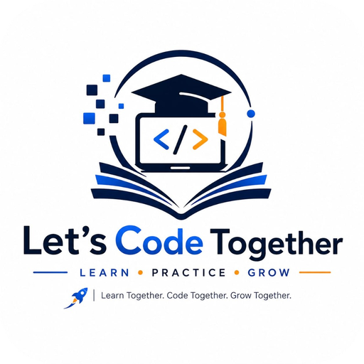

<div align="center">



# 🚀 Let's Code Together

### *The All-in-One Interactive Coding, Learning & Mobile Ecosystem*

<br/>

[](https://github.com/deepakgowrishankar7/Lets-Code-Together-Showcase/releases/tag/v1.0.0)
[-10b981?style=for-the-badge&logo=android&logoColor=white)](https://github.com/deepakgowrishankar7/Lets-Code-Together-Showcase/releases/download/v1.0.0/LetsCodeTogether-v1.0.0.apk)
[](https://lets-code-together.onrender.com)
[](https://reactnative.dev)
[](https://spring.io/projects/spring-boot)

<br/>

**Learn · Code · Compile · Visualize · Communicate — On Web & Android**

*A unified, full-stack educational and development platform combining the interactive learning of LeetCode, the multi-language execution of an online IDE, the execution tracing of a code visualizer, and an ATS resume studio — accessible on desktop and native Android.*

<br/>

### 📲 [**Download Android APK v1.0.0 (Direct CDN)**](https://github.com/deepakgowrishankar7/Lets-Code-Together-Showcase/releases/download/v1.0.0/LetsCodeTogether-v1.0.0.apk) &nbsp;•&nbsp; 🌐 [**Try Live Web Demo**](https://lets-code-together.onrender.com) &nbsp;•&nbsp; 📄 [**Open Showcase Webpage**](https://deepakgowrishankar7.github.io/Lets-Code-Together-Showcase/)

<br/>

---

</div>

## 🎯 What is Let's Code Together?

**Let's Code Together** is a full-stack educational and compilation ecosystem engineered to deliver a unified, zero-friction developer learning environment. It brings together multi-language cloud compilation, real-time algorithm visual tracing, structured computer science curricula, ATS resume generation, and collaborative study rooms into one cohesive platform.

---

## ⚡ Core Features & Capabilities

### 💻 1. Multi-Language IDE & Mobile Compiler
- **8 Supported Languages:** Python 3, Java 21, C++, C, JavaScript (Node.js), Go, Ruby, and PHP.
- **Embedded Execution Engine:** Compile code directly from your smartphone or desktop with instant stdout, stderr, execution duration, and memory utilization statistics.
- **In-Console AI Auto-Debugger:** When syntax or logic bugs trigger runtime errors, the auto-debugger provides precise diagnostics directly in the console and applies fixes with word-by-word animated compiler injection.

### 🔬 2. Real-Time Algorithm Visualizer
- **Step-by-Step Code Tracing:** Watch variables and memory pointers update in real time as algorithms execute.
- **Call Stack & Memory Inspection:** Visualize recursion trees, loop state transitions, and memory pointers to understand complex DSA concepts deeply.

### 🎓 3. Interactive Learning & Interview Hub
- **Core Curriculum:** Java, Python, SQL, and Data Structures & Algorithms.
- **Curated Interview Bank:** Topic-specific questions and technical answers for rapid revision.
- **Full-Screen Focus Mode:** Distraction-free mobile reading mode with text-to-speech audio companion for listening on the go.
- **Knowledge Quizzes:** Scored assessments with visual analytics to track topic retention.

### 📄 4. ATS Interactive Resume Builder
- **Job-Ready Formatting:** Input education, skills, projects, and certifications into high-converting, ATS-compliant formats.
- **Dynamic Profile Derivation:** Automatically links with user profile data for immediate preview and export.

### 💬 5. Real-Time Collaboration & Streaks
- **Public Chat & Direct Messages:** Exchange thoughts, ask questions, and collaborate with peers in real time.
- **Learning Streak & Leaderboards:** Stay accountable with daily activity tracking, challenge completions, and peer rankings.

---

## 📥 How to Install the Android App

1. **Download the APK:**  
   Click the direct download link: [**`LetsCodeTogether-v1.0.0.apk`**](https://github.com/deepakgowrishankar7/Lets-Code-Together-Showcase/releases/download/v1.0.0/LetsCodeTogether-v1.0.0.apk) (Size: 67.12 MB).
2. **Enable Unknown Apps (if prompted):**  
   Tap the downloaded `.apk` file. If Android prompts you with a security alert, select **Settings** and toggle **"Allow from this source"**.
3. **Install & Launch:**  
   Tap **Install**. Once finished, launch **Let's Code Together** and start coding immediately!

---

## 🏗️ System Architecture

```
┌─────────────────────────────────────────────────────────────────┐
│                    User Client Applications                     │
├────────────────────────────────┬────────────────────────────────┤
│     Android Native Mobile      │     Responsive Web Portal      │
│  (React Native / Expo SDK 52)  │    (HTML5 / Tailwind / PWA)    │
└────────────────┬───────────────┴────────────────┬───────────────┘
                 │                                │
                 ▼                                ▼
┌─────────────────────────────────────────────────────────────────┐
│               REST API & WebSocket Stomp Broker                 │
│         (Spring Boot 3.5 • Java 25 • Spring Security 6)        │
├─────────────────────────────────────────────────────────────────┤
│  • JWT Authentication Filter    • Multi-Language Code Runner    │
│  • Course & Topic Engine        • Real-Time Chat & Direct Msg   │
│  • Quiz Assessment Controller   • ATS Resume Service            │
└────────────────┬────────────────────────────────┬───────────────┘
                 │                                │
                 ▼                                ▼
┌─────────────────────────────────┐  ┌────────────────────────────┐
│      Relational Persistence     │  │       Execution Pool       │
│     (MySQL 8.0 / Hibernate 6)   │  │   (Isolated Code Sandbox)  │
└─────────────────────────────────┘  └────────────────────────────┘
```

---

## 🛠️ Technology Stack

| Layer | Technologies |
|---|---|
| **Mobile Client** | React Native, Expo SDK 52, Lucide Icons, React Navigation |
| **Web Frontend** | HTML5, Tailwind CSS, Monaco Code Editor, Chart.js, PWA |
| **Backend Core** | Spring Boot 3.5, Java 25, Spring Data JPA, Spring Security 6, JJWT |
| **Execution Sandboxes** | Python 3, OpenJDK 21, GCC (C/C++), Node.js, Go, Ruby, PHP |
| **Database** | MySQL 8.0, Hibernate 6 ORM, Flyway Migrations |
| **DevOps & CI/CD** | Docker, Render Cloud, GitHub Actions (Automated Gradle Builds) |

---

## 👨‍💻 About the Creator & Architect

<div align="center">


### **Deepak Gowri Shankar Enduri**
**CREATOR & LEAD ARCHITECT**  
`B.Tech • Computer Science & Engineering (CSE)`

[](https://deepakgowrishankar7.github.io/Portfolio/)
[](mailto:deepakgowrishankar7@gmail.com)

</div>

> *"During my engineering journey in Computer Science & Engineering (CSE), I noticed a fundamental flaw with many modern coding learning platforms: they are either bloated enterprise suites with overwhelming complexity or fragile, disconnected tools where students constantly juggle between separate editors, terminal windows, video tutorials, and AI helpers.*
>
> *I engineered **Let's Code Together** to deliver a unified, zero-friction developer learning ecosystem. Every component — from the multi-threaded code compilation pipeline and Monaco editor integration to the interactive 3D visualizers, live collaborative code rooms, and the autonomous Zetrox AI Mentor — was custom-designed for seamless interactive learning, real-time collaboration, and developer confidence."*

---

## 🔗 Project Links

- 📲 **Official Android APK:** [Download v1.0.0](https://github.com/deepakgowrishankar7/Lets-Code-Together-Showcase/releases/download/v1.0.0/LetsCodeTogether-v1.0.0.apk)
- 🌐 **Live Web Portal:** [https://lets-code-together.onrender.com](https://lets-code-together.onrender.com)
- 💻 **Showcase Landing Page:** [https://deepakgowrishankar7.github.io/Lets-Code-Together-Showcase/](https://deepakgowrishankar7.github.io/Lets-Code-Together-Showcase/)
- 📦 **GitHub Releases:** [Showcase Releases v1.0.0](https://github.com/deepakgowrishankar7/Lets-Code-Together-Showcase/releases)

---

<div align="center">

Developed & Architected by **[Deepak Gowri Shankar Enduri](https://github.com/deepakgowrishankar7)**  
*Empowering every developer to learn, build, and grow together.*

</div>
